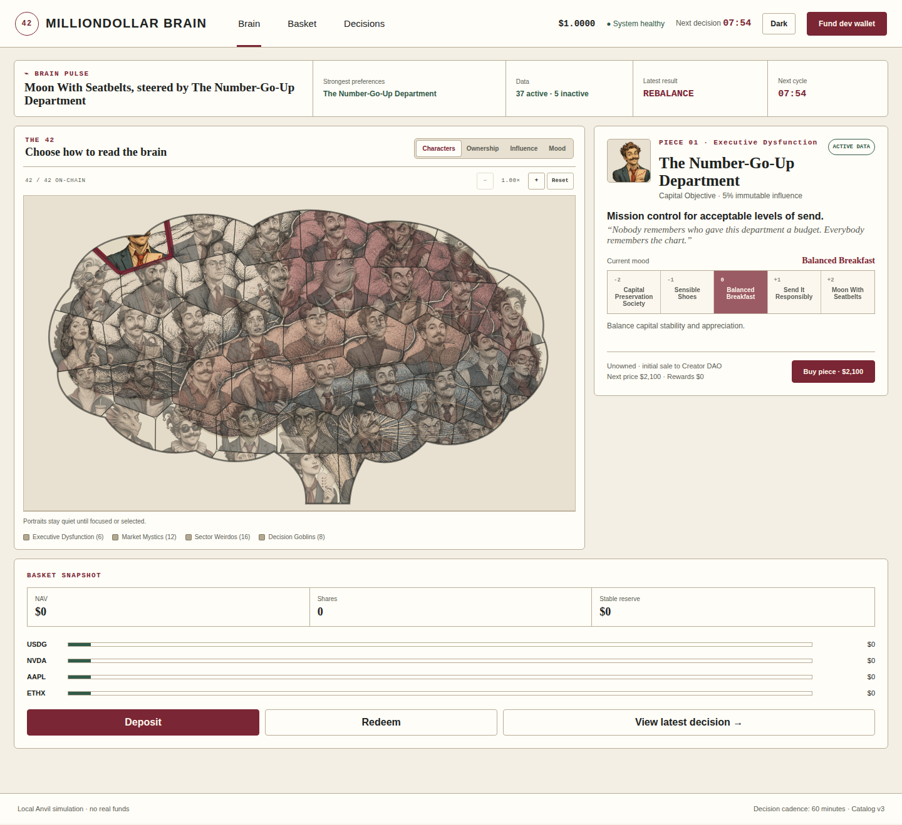
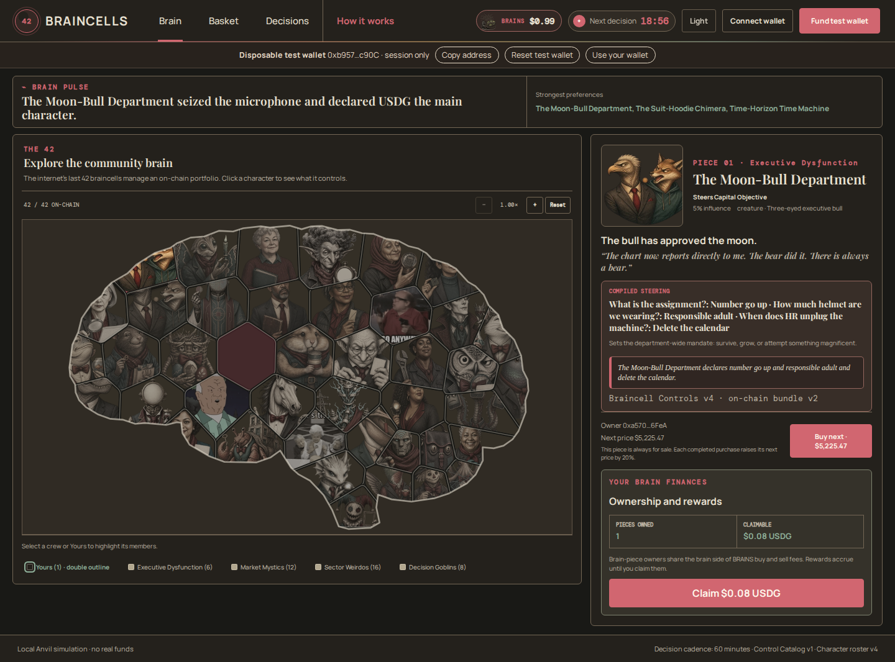
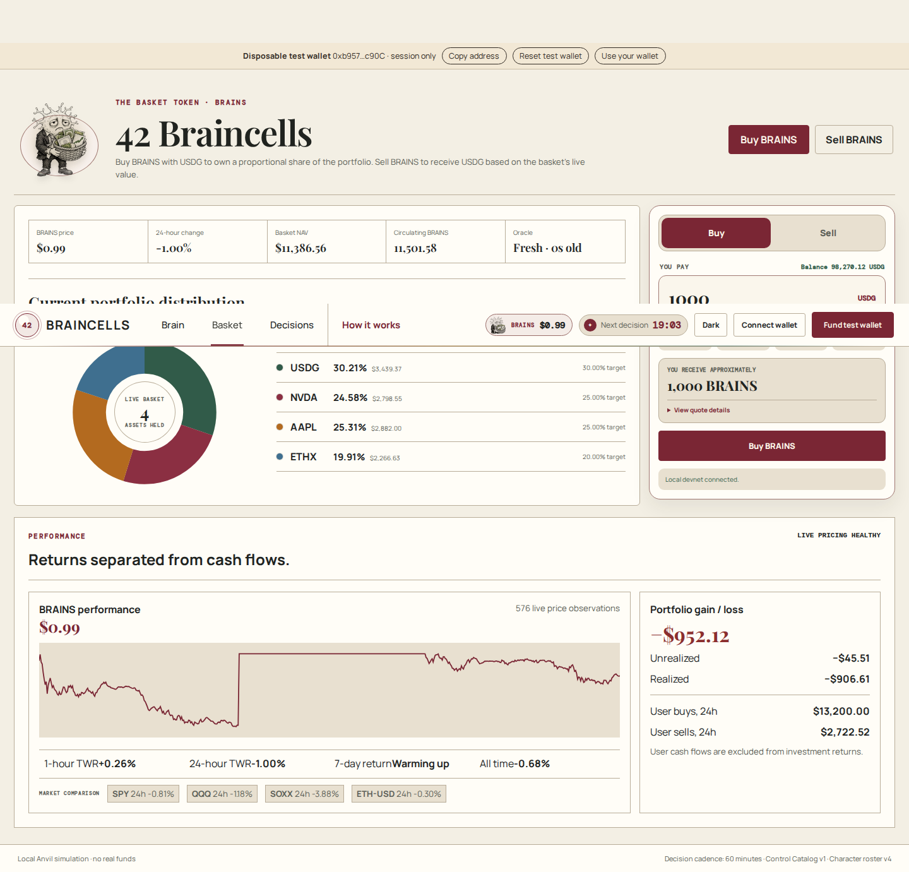
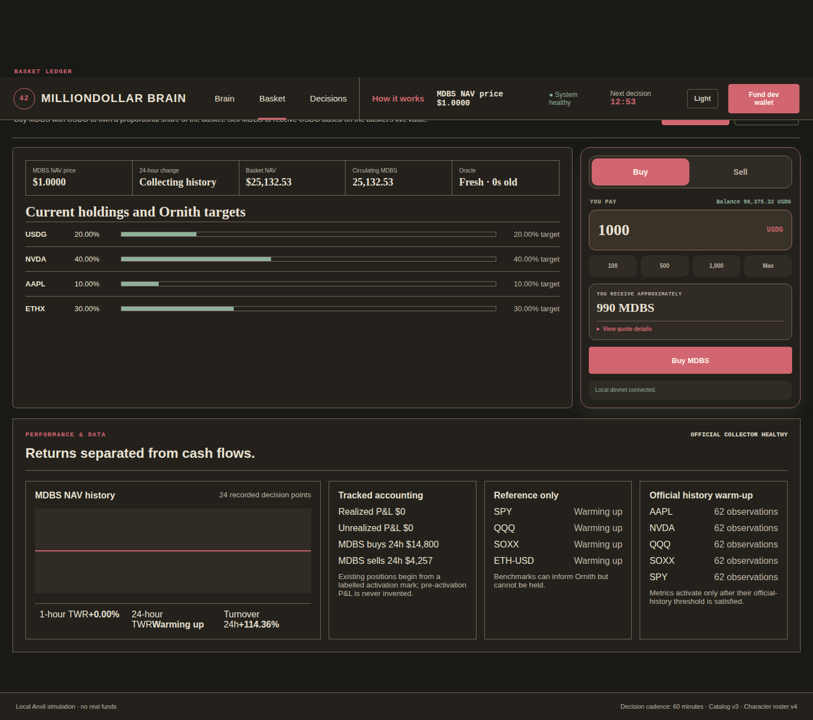
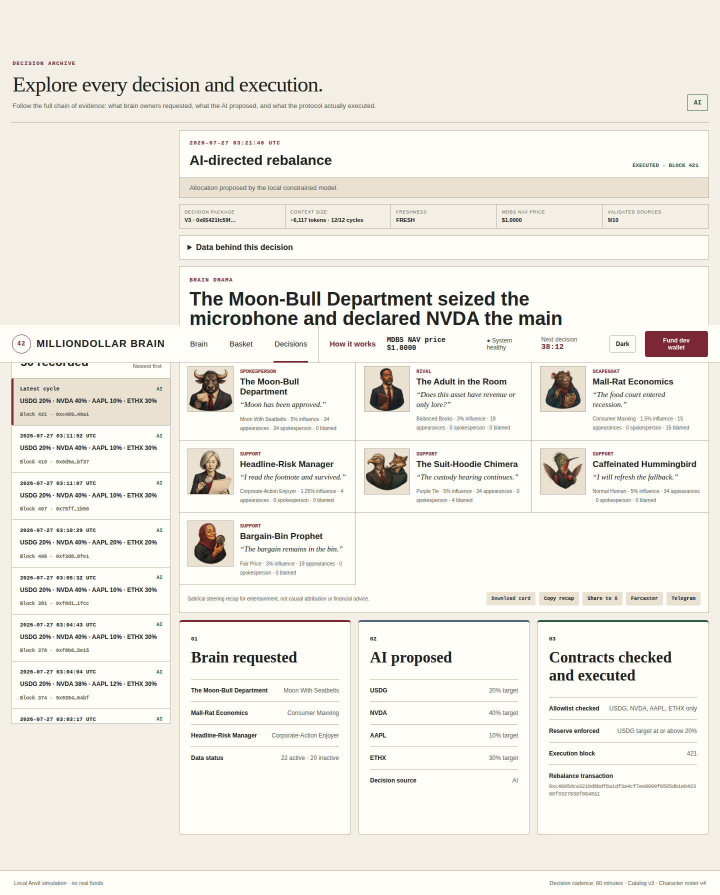
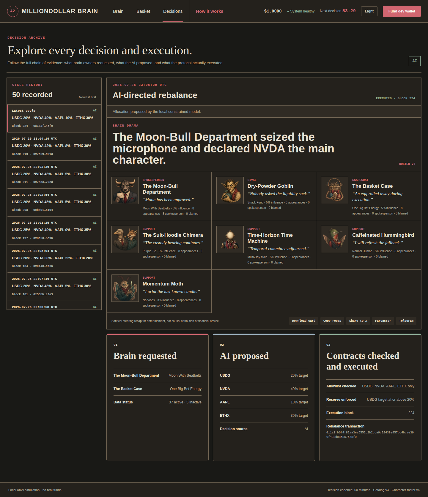

# 42 Braincells

## Product Requirements Document

**Version:** 1.1
**Status:** Mainnet-edge engineering candidate; real-value activation disabled
**Date:** 2026-07-28
**Implementation status:** Local Anvil remains usable. A fresh public
chain-46630 V3 replica deployment is live with a dynamic asset registry, signed
RFQ plans, atomic buys/sells, and autonomous DecisionContext V4 Ornith cycles.
A separate chain-4663 mainnet shadow is read-only and rejects signing keys and
broadcast mode. No mainnet deployment or real-value activation has occurred.

### Normative PRD set

This PRD is the top-level product authority. The following linked specifications are normative parts of the PRD and contain details that would make this file unnecessarily repetitive:

| Specification             | Authority                                                                                                 |
| ------------------------- | --------------------------------------------------------------------------------------------------------- |
| `BRAIN_PRESET_CATALOG.md` | All 42 pieces, options, defaults, weights, effects, confidence thresholds, and data dependencies          |
| `BRAIN_SCHEMA.md`         | Brain compilation, conflict resolution, Asset Registry, model input, and model output schemas             |
| `AI_DATA_POLICY.md`       | Free data sources, deterministic calculations, asset dossiers, no-browsing policy, and failure behavior   |
| `AI_EXPLAINABILITY.md`    | Brain-to-proposal-to-execution attribution and public explanation requirements                            |
| `KEEPER_GAS_POLICY.md`    | Server wallet, Automation Reserve, ETH refilling, reimbursements, permissions, and key separation         |
| `UX_SCREENS.md`           | Screen consolidation, drawers, modals, system states, and mobile behavior                                 |
| `TECH_STACK.md`           | Frontend libraries, SVG brain, testing, and native Ubuntu deployment                                      |
| `CHAIN_COMPATIBILITY.md`  | Local Anvil, Robinhood networks, asset adapters, wallets, oracles, execution venues, and browser UAT      |
| `DESIGN_SYSTEM.md`        | Accepted light and dark mockups, exact design tokens, typography, theme behavior, and accessibility       |
| `BUILD_READINESS.md`      | Locked economics, limits, model settings, infrastructure, release criteria, and external production gates |

If an older concept note conflicts with this PRD set, this PRD set controls. `PRODUCT_BRIEF.md` is retained only as historical product context.

## 1. Product summary

**The internet's last 42 braincells manage an on-chain portfolio.**

42 Braincells is a community-steered portfolio protocol on Robinhood Chain.

Users deposit an approved base asset into a basket and receive transferable basket shares priced from net asset value. A constrained AI reviews the portfolio on a schedule, initially hourly, and proposes the basket's target holdings for the next hour. Deterministic contracts enforce asset, risk, turnover, liquidity, oracle, and execution restrictions before any trade occurs.

The AI is steered by a visual brain containing exactly 42 always-for-sale pieces. Each piece has an immutable affinity, immutable influence weight, and closed set of protocol-defined options. Owners can select among the allowed options but cannot submit text or instructions.

Protocol revenue is divided between:

- A creator-controlled vault called the Creator DAO Vault in the MVP.
- Brain-piece owners, who claim rewards according to their pieces' immutable weights.

## 2. Product thesis

The product combines three ideas:

1. A transparent, on-chain basket whose shares can be entered and redeemed at NAV.
2. A scarce, tradable control surface that lets users steer a constrained portfolio model.
3. A public AI portfolio process in which context, proposals, constraints, executions, and results are auditable.

The AI does not custody assets or control a private key. It proposes portfolio targets. Upgradeable smart contracts and authorized automation execute only validated actions.

## 3. Goals

### 3.1 Primary goals

- Let users enter and exit a shared on-chain basket using NAV-priced shares.
- Let brain-piece owners steer the AI through closed, auditable settings.
- Produce one constrained portfolio decision on a configurable schedule.
- Restrict the AI to a governance-approved asset universe.
- Execute accepted allocations through deterministic risk and execution rules.
- Make holdings, NAV, decisions, fees, ownership, rewards, and transactions public.
- Let the creator withdraw protocol revenue from a dedicated vault.
- Keep every protocol contract upgradeable.

### 3.2 Secondary goals

- Support either OpenRouter or the user's local AI appliance behind one provider interface.
- Minimize unnecessary trades through allocation bands and minimum trade thresholds.
- Use deposits, redemptions, and the stable-asset reserve to reduce rebalancing turnover.
- Allow future governance and decentralization without requiring it in the MVP.

## 4. Non-goals for the MVP

- Arbitrary user-authored brain text.
- AI-controlled private keys or unrestricted tool use.
- Docker, container images, or container-orchestrated deployment.
- AI discovery or purchase of arbitrary token contracts.
- Leverage, borrowing, lending, shorting, options, or perpetual futures.
- Permissionless asset listing.
- Full decentralized governance.
- Creator voting, grant proposals, delegation, or DAO elections.
- Cross-chain basket assets.
- Guaranteed returns, principal protection, or investment advice claims.
- Mainnet launch before legal review, simulation, testnet validation, and security audits.
- Automatic activation or trading of every token discovered on-chain.

## 5. Product actors

### 5.1 Basket participant

A user who deposits the base asset, receives basket shares, transfers shares, or requests redemption.

### 5.2 Brain-piece owner

A wallet that owns one or more brain pieces, selects their allowed options, receives reward accrual, and may be bought out at the displayed on-chain price.

### 5.3 Creator

The initial owner of the Creator DAO Vault and protocol administrative roles. The creator may withdraw revenue belonging to the Creator DAO Vault but must not directly withdraw basket principal or brain-owner reward liabilities.

### 5.4 AI allocator

An off-chain constrained model that receives a versioned decision package and returns proposed target weights for approved assets.

### 5.5 Scheduler or keeper

An authorized or permissionless caller that submits a signed scheduled proposal and pays transaction gas before any permitted reimbursement.

### 5.6 Upgrade administrator

The authority that can upgrade protocol implementations. Creator-controlled development authority is permitted on local Anvil and early testnet. Before real value, upgrade authority moves to a 2-of-3 multisig with a 48-hour timelock for normal upgrades.

## 6. Product components

The MVP consists of the following upgradeable components:

1. **Basket Vault and Share Token**
   - Holds approved basket assets.
   - Calculates or consumes validated NAV inputs.
   - Mints and burns transferable basket shares.

2. **Brain NFT**
   - Represents exactly 42 brain pieces.
   - Stores each piece's immutable identity and influence weight.
   - Restricts transfers to the Brain Marketplace.

3. **Brain Settings Registry**
   - Stores each piece's affinity, allowed option IDs, default, current selection, and version.

4. **Brain Marketplace**
   - Sells unowned pieces at their initial price.
   - Enforces always-for-sale secondary purchases at 120% of the last settled price.
   - Routes principal and markup revenue atomically.

5. **Reward Distributor**
   - Accrues brain-owner rewards using a reward-per-weight index.
   - Checkpoints rewards before brain ownership changes.

6. **Creator DAO Vault**
   - Receives the creator share of protocol revenue.
   - Allows the creator-controlled owner role to withdraw available funds.
   - Has no voting or proposal system in the MVP.

7. **Asset Registry**
   - Stores approved asset IDs, token contracts, categories, risk tiers, and active status.

8. **Oracle Adapter**
   - Normalizes approved price sources.
   - Enforces freshness and deviation rules.

9. **Allocation and Risk Controller**
   - Accepts signed AI target proposals.
   - Enforces schema, schedule, asset, exposure, turnover, and circuit-breaker rules.

10. **Trade Executor**
    - Converts accepted targets into bounded trades.
    - Interacts only with approved venues and assets.

11. **Automation and Reimbursement Module**
    - Tracks scheduled cycles.
    - Prevents duplicate execution.
    - Maintains a fee-funded Automation Reserve.
    - Refuels the registered Keeper Wallet with native ETH through a bounded approved route.
    - Reimburses eligible cycle submissions under a capped policy.

12. **Upgrade Administration**
    - Controls implementation upgrades for every protocol contract.
    - Records upgrade events and implementation versions.

## 7. Basket requirements

### 7.1 Basket shares

- The basket share must be a standard transferable ERC-20-compatible share.
- The token name is `MillionDollar Basket Share`, symbol `MDBS`, with 18 decimals.
- Supply expands when deposits mint shares.
- Supply contracts when redemptions burn shares.
- Raw share transfers have no protocol transfer tax.
- Share balances represent proportional economic claims on basket NAV, subject to fees and redemption rules.

### 7.2 NAV

At a high level:

`NAV per share = (priced basket assets - accrued liabilities - reserved costs) / circulating shares`

NAV must include:

- Current approved asset balances.
- Fresh approved oracle prices.
- Accrued creator and brain-owner fee liabilities.
- Reserved redemption and execution costs where applicable.
- Conservative treatment of paused, stale, or illiquid assets.

### 7.3 Deposit

MVP economics:

```text
entry fee = deposit amount × 1%
net contribution = deposit amount - entry fee
actual NAV added = post-swap NAV - pre-deposit NAV
shares minted = actual NAV added × pre-deposit supply ÷ pre-deposit NAV
```

Requirements:

- Deposits are available on-chain at any time when prices are valid.
- The user supplies a minimum acceptable share amount.
- The transaction reverts if prices are stale or minted shares fall below the user's minimum.
- The vault retains the current USDG reserve fraction and buys every positively held risk asset in proportion to its pre-deposit basket value.
- At zero supply, governance-configured bootstrap weights replace pre-deposit actual weights and initial shares mint at one USDG of actual NAV added.
- Valuation and execution are separate: accepted swap results must remain inside protocol and user slippage bounds around fresh valuation-adapter prices.
- Sub-trade dust below one basis point may remain in USDG and is included in actual NAV added.
- The user pays only their deposit transaction gas.

### 7.4 Redemption

MVP economics:

```text
gross redemption = shares burned × current NAV per share
redemption fee = gross redemption × 1%
net user value = gross redemption - redemption fee
```

Requirements:

- Atomic redemptions are available on-chain at any time.
- The user supplies a minimum acceptable redemption value.
- Every redemption sells the exact ownership fraction of every positively held risk asset, combines those proceeds with the same fraction of the USDG reserve, deducts the fee, burns the shares, and returns USDG in one transaction.
- If any required sale cannot execute within price freshness, liquidity, deadline, or slippage protections, the entire transaction reverts and no balances or holdings change.
- New queued redemptions and keeper settlement are disabled. Legacy queue storage and events remain only for upgrade compatibility.
- Stock Tokens are not distributed in kind in the MVP.
- The user pays only their redemption transaction gas.

## 8. Brain requirements

The proposed affinity, weighting, aggregation, and asset-selection design is maintained in `BRAIN_SCHEMA.md`. Complete option meanings, defaults, effects, and data dependencies are maintained in `BRAIN_PRESET_CATALOG.md`. The free-source, deterministic-calculation, no-browsing, and asset-universe rules are maintained in `AI_DATA_POLICY.md`.

### 8.1 Fixed supply

- The brain contains exactly 42 pieces.
- No additional pieces may be created.
- Each piece has a unique visual region and ID.
- Pieces have different sizes and immutable influence weights.
- All piece weights sum to 10,000 basis points.

### 8.2 Affinities and options

Each piece stores:

- Immutable affinity ID.
- Immutable influence weight.
- Closed protocol-defined option list.
- Default option.
- Current selected option.
- Selection version.
- Last selection timestamp.

Owners may:

- View every affinity, option, weight, and selection.
- Select one allowed option for each owned piece.
- Change the selection at any time on-chain.

Owners may not:

- Enter text, links, instructions, prompts, or contract addresses into the AI
  steering context.
- Select an option not defined for that piece.
- Change the piece's affinity or weight.
- Override the asset registry or hard risk controls.

A change made after the current AI snapshot affects the next scheduled cycle.

### 8.2.1 Owner profile customization

- Each purchaser receives one combined name-and-portrait customization for that
  ownership period.
- The owner may use it at any time after purchase; it is not part of the buy
  transaction.
- The application center-crops the chosen PNG, JPEG, or WebP to a 384-by-384
  WebP, validates a nonempty name of at most 48 UTF-8 bytes, and commits the
  name and exact image-content hash together in one wallet transaction. It then
  self-hosts the matching image bytes.
- The contract accepts one profile update per ownership serial. A second name
  or image change reverts.
- A completed always-for-sale purchase advances the ownership serial and gives
  the new purchaser one fresh combined customization. The existing name and
  portrait remain visible until that purchaser changes them.
- Custom names and portraits are presentation only. They never enter the
  allocator prompt, replace the immutable character identity, change affinity,
  alter influence, grant asset permissions, or affect fees.
- The UI validates file type and size. The image service stores bytes only when
  their hash equals the piece's current on-chain commitment.
- The contract admin may moderate an image by resetting its portrait hash to
  the canonical image. Moderation does not change the custom name, ownership,
  ownership serial, or consumed profile-customization allowance.

### 8.3 Initial brain-piece purchase

- Each unowned piece has an on-chain initial price.
- The full initial purchase price goes to the Creator DAO Vault.
- No initial-sale proceeds go to brain-owner rewards.
- Ownership transfer and payment routing are atomic.
- The initial piece price equals the deployment's initial total brain valuation multiplied by the piece's immutable weight and divided by 10,000.
- The MVP initial total brain valuation is fixed at 42,000 USDG and applies uniformly through that formula.
- Prices do not decay, and the administrator cannot selectively reprice an individual piece in the MVP.

### 8.4 Always-for-sale secondary purchase

```text
buyer payment = previous settled price × 1.20
seller payment = previous settled price
protocol markup = previous settled price × 0.20
```

The markup is split:

- 50% to the Creator DAO Vault.
- 50% to the Brain Reward Distributor.

Requirements:

- The current owner cannot reject a valid purchase at the displayed price.
- The purchase must use the official marketplace.
- Direct transfers are disabled.
- The buyer supplies a maximum acceptable price and deadline.
- Rewards are checkpointed before ownership changes.
- The new settled price becomes the amount paid by the buyer.
- The next displayed price becomes 120% of the new settled price.

The piece being transferred is excluded from the reward distribution generated by its own sale. Neither the outgoing owner nor incoming owner receives rewards from that piece for that transaction.

The brain-owner half of the markup is distributed across all other currently owned pieces in proportion to their immutable influence weights. If no other piece is owned, that amount goes to the Creator DAO Vault rather than becoming a retroactive reward for a future buyer.

## 9. Fee and reward requirements

### 9.1 Basket fees

The MVP rates are:

- 1% entry fee.
- 1% redemption fee.

Every collected basket fee is split:

- 50% to the Brain Reward Distributor.
- 40% to creator-withdrawable Creator DAO Vault revenue.
- 10% to the Automation Reserve inside the Creator DAO Vault.

The Automation Reserve allocation is part of the creator side of the original 50/50 split. It is not an additional user fee. The complete wallet, refueling, permission, and reimbursement policy is defined in `KEEPER_GAS_POLICY.md`.

The MVP does not charge:

- A basket-share transfer tax.
- A protocol fee on internal basket rebalances.
- A management fee against NAV.
- A performance fee on gains.
- A preset-change or reward-claim fee beyond the user's transaction gas.

### 9.2 Brain-owner rewards

- Rewards accrue according to the immutable weights of owned pieces.
- Rewards use a global reward-per-weight accumulator.
- Ownership transfers checkpoint the seller before transfer.
- Previously accrued rewards remain claimable by the prior owner.
- The new owner earns only after the transfer checkpoint.
- MVP reward liabilities and claims are denominated and paid in USDG.
- Claims are available on-chain at any time.
- Claims do not loop through all 42 pieces.
- Unclaimed rewards do not expire in the MVP.
- Fee-event rewards are distributed only across pieces owned and eligible at that event.
- If no piece is eligible for a basket-fee or markup reward event, the brain-owner portion goes to the Creator DAO Vault; future buyers cannot claim historical undistributed fees.

### 9.3 Revenue isolation

The system must keep separate accounting for:

- Basket principal and assets.
- Accrued redemption liabilities.
- Brain-owner reward liabilities.
- Creator DAO Vault revenue.
- Keeper reimbursement budget.

The Creator DAO Vault must receive only protocol revenue intended for the creator side of the split. A normal vault withdrawal function must not withdraw basket principal or brain-owner liabilities.

Automation Reserve USDG is committed operating revenue and is not creator-withdrawable while reserved. It may be used only for approved gas conversion, Keeper Wallet refilling, and capped cycle reimbursement.

## 10. AI allocation requirements

### 10.1 Schedule

- The initial target schedule is one decision cycle per hour.
- The final interval must be configurable through an upgradeable or administrative parameter.
- AI cycles are independent of user deposits, redemptions, brain activity, claims, and governance actions.
- Each cycle uses an immutable brain, Asset Registry, portfolio, price, and data snapshot identified by versions and hashes.
- A brain setting changed after the snapshot affects the next cycle.
- Deposits and redemptions after proposal creation do not change its percentage targets; deterministic execution applies accepted targets to the then-current balances and NAV.
- A valid proposal expires when its deadline passes or a newer cycle supersedes it.

### 10.2 Model providers

The allocator must support a provider-neutral interface for:

- The primary model running on the user's local GPU45 appliance.
- A future approved OpenRouter fallback.

Provider changes must not require changes to basket, brain, marketplace, reward, or execution contracts.

Primary model:

| Property           | Value                                  |
| ------------------ | -------------------------------------- |
| Provider           | GPU45 local appliance                  |
| Base URL           | `http://192.168.50.189:30001/v1`       |
| Model              | Ornith 1.0 35B MoE Q5_K_M              |
| Live API model ID  | `ornith-1.0-35b-Q5_K_M-688b8d0a`       |
| Codex/catalog slug | `gpu45-ornith-1-0-35b-q5-k-m-688b8d0a` |
| Modality           | Text only                              |
| Context            | 262,144 tokens                         |
| Role               | Primary hourly portfolio allocator     |

Text-only operation is sufficient because the model receives structured text and JSON. Images are not part of the allocation input.

Live validation on 2026-07-25 confirmed:

- The appliance advertised the model through `/v1/models`.
- `/v1/responses` accepted the exact live model ID.
- With sufficient output allowance, the model returned the requested final JSON exactly.
- A 128-token output allowance was insufficient because the reasoning model consumed the budget before emitting its final answer.

The production adapter must:

- Ignore reasoning-stream events for allocation parsing.
- Parse only the final assistant `output_text`.
- Reserve enough output tokens for both reasoning and the final allocation object.
- Validate the final JSON against the protocol schema.
- Reject missing, truncated, duplicated, or malformed final output.
- Record reasoning-token and final-output-token usage separately when available.

Every cycle records:

- Provider identifier.
- Exact model identifier.
- Model configuration.
- Prompt and schema versions.
- Brain version.
- Asset-registry version.
- Input hash.
- Output hash.

### 10.3 Complete decision context

Every cycle supplies:

- Protocol constitution.
- All 42 affinities, selected options, weights, and canonical option meanings.
- Approved asset IDs, contracts, categories, risk tiers, and active status.
- Current asset prices, price ages, liquidity, volume, spreads, volatility, and recent returns.
- Current basket balances, values, weights, NAV, reserve, and target drift.
- Realized and unrealized performance where available.
- Recent trades, turnover, fees, deposits, and redemptions.
- Previous target allocation and execution result.
- Current risk, turnover, trade-size, slippage, and circuit-breaker limits.
- Complete structured dossiers for every active asset, including source timestamps, formula versions, and validity flags.
- At most 12 compact detailed cycles. Older history enters only through fixed 24-hour, 7-day, and 30-day rollups.

No user-authored text enters the model context.

The complete brain is supplied in two forms:

- Piece-by-piece affinities, options, selections, and weights.
- A normalized machine-readable preference vector produced by aggregating the selected option effects.

The asset catalog is supplied from the on-chain Asset Registry and contains only active, approved assets. Dynamic market statistics are supplied by approved data adapters and included in the cycle input hash.

Ornith receives one compact fixed-schema row for every qualified asset; there
is no fixed candidate-count ceiling. It receives full dossiers for current
holdings and the deterministic top 64 assets, but may return no more than nine
risk positions plus USDG. All external information comes from structured
Robinhood, Chainlink, Robinhood Chain, SEC EDGAR, FRED, Coinbase, portfolio,
and validated 0x sources. Versioned protocol code calculates derived metrics.

Every model request is stateless, contains one freshly built
`DecisionContextV4`, has no conversation ID or prior messages, and is rejected
before dispatch if the deterministic 96,000-token estimate is exceeded. The
compact eligible directory has priority; if it cannot fit, the cycle holds and
raises an alert. Ornith may request one bounded research round for at most 16
registered asset identities. The orchestrator returns only recorded structured
evidence and never arbitrary URLs, prose, user-selected contracts, or browsing.
Required stale portfolio, valuation, quote, halt, or execution state produces
a Hold. PostgreSQL stores both model calls, exact contexts, hashes, research,
raw outputs, validated allocation, snapshots, observations, accounting,
outcomes, and execution or simulation receipts.

The native market collector samples official Robinhood quotes for every
registered candidate and configured reference-only benchmark. It applies the
Stock Token multiplier, deduplicates source timestamps, builds retained
one-minute, 15-minute, hourly, and daily candles, and calculates versioned
returns, volatility, drawdown, momentum, mean reversion, spread, liquidity,
execution cost, relative strength, correlation, and beta. Features mature only
from post-activation official history; no third-party backfill is permitted.
ETH-USD remains an official Coinbase reference series, and FRED remains
optional until configured.

On local Anvil only, each successful collector pass also synchronizes the mock
valuation oracle and mock execution router to the same fresh official AAPL,
NVDA, and Coinbase ETH-USD prices. Both values are verified after mining and
rolled back together if the paired update cannot complete. This makes local MDBS
NAV and P&L move with the market without presenting mock prices as production
oracles. Testnet and mainnet use approved production valuation and execution
adapters instead.

Portfolio accounting uses a clearly labelled activation mark plus post-activation vault events and receipts. It tracks weighted-average basis, realized/unrealized P&L, time-weighted returns, turnover, fees, gas, deposits, redemptions, and one-hour/24-hour decision outcomes. Reference assets are structurally non-executable and cannot appear in a validated allocation.

### 10.4 Model output

The model may return only:

- Cycle ID.
- Decision: rebalance or hold.
- Approved asset IDs.
- Integer target weights totaling exactly 10,000 basis points.
- Confidence score.
- Approved reason codes.
- Approved brain-factor IDs cited by the model.
- Affected approved asset IDs for each cited factor.
- A bounded, non-executable explanation.

The model may not return:

- New token contracts.
- Contract calls or calldata.
- Private-key or wallet instructions.
- Asset listings.
- Risk-limit changes.
- Governance actions.
- Arbitrary executable instructions.

The explainability and attribution requirements are defined in `AI_EXPLAINABILITY.md`. Raw reasoning-stream content is not an authoritative decision artifact. The official model artifact is the final schema-valid `output_text`.

### 10.5 Failure behavior

The system holds the current allocation when:

- The provider is unavailable.
- The response is late or malformed.
- Schema validation fails.
- Input or oracle data is stale.
- The cycle, nonce, version, or input hash is wrong.
- The risk controller rejects the proposal.
- Safe execution is unavailable.

Failure must not trigger an unapproved provider or model automatically unless that fallback has been explicitly configured and tested.

### 10.6 Keeper Wallet and gas

- The automation server has a registered Keeper Wallet funded with native ETH.
- The allocator proposal signer and Keeper Wallet use separate keys.
- Ornith and the model-provider process never receive either private key.
- The Keeper Wallet may submit only due signed allocations or Hold records through the Allocation and Risk Controller.
- The wallet is refueled from the fee-funded Automation Reserve under the rules in `KEEPER_GAS_POLICY.md`.
- At most one gas reimbursement is paid per eligible cycle.
- Low gas produces a public warning; insufficient gas produces a missed cycle and no portfolio change.
- A backup keeper may submit an unexpired valid proposal.

### 10.7 Off-chain deployment

- The application and automation VM is Ubuntu 24.04 LTS at `192.168.50.135`.
- The repository path is `/home/hendo420/projects/million-dollar-brain`.
- The private GitHub repository is `fourtytwo42/million-dollar-brain`.
- The GPU45 model appliance remains separate at `192.168.50.189`.
- Services install directly on the VM and run under `systemd`; Docker and PM2 are excluded.
- Caddy terminates HTTPS and proxies only to localhost-bound application services.
- Keeper and allocator signing keys remain outside the repository, frontend, model process, logs, and normal environment files.
- Frontend and deployment details are controlled by `TECH_STACK.md`.

### 10.8 Network environments

- Daily contract and integration development uses local Anvil on chain ID 31337.
- Robinhood Chain testnet uses chain ID 46630. Server processes use a
  loopback failover gateway whose primary is the LAN testnet node at
  `192.168.50.117:8547` and whose secondary is the configured remote HTTPS
  provider. The gateway checks chain identity, sync state, and both heads every
  15 seconds; it fails over when the LAN node is unavailable, on the wrong
  chain, syncing, or more than three blocks behind.
- Browser wallets always use the public HTTPS Robinhood Testnet RPC. LAN and
  credential-bearing provider URLs are never exposed to browser bundles.
- Failback requires four consecutive healthy LAN samples within one block of
  the remote head. Ambiguous raw-transaction transport failures are never
  replayed automatically across providers.
- Robinhood Chain mainnet uses chain ID 4663.
- The public testnet RPC is acceptable for testnet but must not be the sole mainnet RPC because it is rate-limited and not production-grade.
- Devnet uses port 3000, `local-v3.json`, `var/devnet`, and
  `milliondollarbrain_devnet`. Testnet uses port 3001, `testnet-v3.json`,
  `var/testnet-v3`, and `milliondollarbrain_testnet`. Mainnet canary uses port
  3003, `mainnet-v3.json`, `var/mainnet`, and
  `milliondollarbrain_mainnet`.
- Each environment has isolated history, portrait storage, RPCs, secrets,
  operator identity, services, and timers. Promotion uses the exact same clean
  pushed Git SHA and web/contract artifact hashes; testnet or mainnet is never
  independently patched.
- Devnet acceptance creates a release candidate. Contract, wallet, valuation,
  execution, or accounting changes require a fresh two-hour testnet
  acceptance. Mainnet additionally requires fork rehearsal and 48 continuous
  qualification hours, including two regular US market sessions for every
  launch stock or ETF.
- Mainnet first deploys as a LAN-only paused canary. Basket buys, sells,
  autonomous rebalancing, and brain purchases activate in separately recorded
  stages. The apex domain remains Coming Soon until explicit activation.
- Contracts, ABIs, data schemas, and service behavior remain identical between environments; versioned network configuration supplies addresses and endpoints.
- Local Anvil provides mock USDG, ERC-20, ERC-8056 Stock Token, Chainlink, sequencer, router, liquidity, halt, and corporate-action behavior.
- The complete network specification is defined in `CHAIN_COMPATIBILITY.md`.

## 11. Portfolio compiler and execution requirements

The AI chooses targets. Deterministic code chooses whether and how to trade.

The AI returns target weights rather than buy and sell instructions. For each asset, the compiler derives the required trade from the difference between current value and target value.

The compiler must consider:

- Current holdings and target drift.
- Base-asset reserve.
- Recent deposits and redemption needs.
- No-trade bands.
- Per-asset exposure limits.
- Maximum positions.
- Cycle and daily turnover.
- Minimum trade size.
- Liquidity and expected price impact.
- Slippage limits.
- Oracle freshness.
- Circuit-breaker state.
- Estimated gas and execution cost.

Execution uses allowlisted venue adapters rather than model-authored calldata. The adapter boundary can support Uniswap-compatible AMMs, signed RFQ or aggregator quotes, validated propAMMs, and validated order books. Every trade enforces an exact input or bounded maximum input, minimum proceeds, deadline, oracle deviation, slippage, token, venue, and allowance target.

The system is architected for standard ERC-20 assets and Robinhood Stock Tokens using ERC-8056. Every official Stock Token may be discovered and represented, but an asset cannot enter the active decision universe until its canonical contract, multiplier behavior, oracle, sequencer checks, liquidity, execution route, transfer behavior, permissions, and legal eligibility pass review.

Initial hard limits:

- Approved spot assets only.
- Maximum nine risk positions plus USDG.
- Maximum 20% in one asset.
- Minimum 20% in the base stable asset.
- Maximum 30% combined in high-volatility assets.
- Maximum 10% turnover per scheduled cycle.
- Maximum 35% turnover per day.
- No leverage or derivatives.

Proposal validation and execution are atomic and all-or-nothing in the MVP so observers cannot act on a published target that is only partly executed. Any planned trade failure reverts the complete rebalance.

## 12. Creator DAO Vault requirements

The MVP DAO is intentionally simple.

### 12.1 Included functionality

- Upgradeable revenue vault.
- Creator-controlled owner role.
- Receive initial brain-piece revenue.
- Receive 50% of basket entry and redemption fees.
- Receive 50% of secondary brain-piece markups.
- Account separately for creator-withdrawable revenue and the Automation Reserve.
- Convert reserved USDG to native ETH only through the approved capped refueling route.
- Fund scheduler and Keeper Wallet gas.
- Withdraw available funds to an owner-selected address.
- Emit events for every deposit, reimbursement, and withdrawal.
- Show current balance and historical flows in the dashboard.

### 12.2 Excluded functionality

- Token voting.
- Proposals.
- Delegation.
- Quorum.
- Creator membership.
- Automated creator distributions.
- Grant management.

These may be added through a later upgrade.

### 12.3 Owner safety

- The owner may withdraw Creator DAO Vault funds.
- The owner must not have a direct Creator DAO Vault function that transfers basket principal or brain reward liabilities.
- Local and early testnet development may use a creator EOA. Before real value, creator withdrawal authority moves to the approved 2-of-3 multisig.
- Ownership transfer must use a two-step accept process.

## 13. Upgradeability requirements

Every protocol smart contract must be upgradeable.

Requirements:

- Use one documented upgrade pattern consistently unless a component has a recorded reason to differ.
- Separate proxy storage from implementation logic.
- Use namespaced or otherwise collision-safe storage layouts.
- Include initializer protection.
- Disable initialization on implementation contracts.
- Preserve storage compatibility across upgrades.
- Version every implementation.
- Emit upgrade and administrative-change events.
- Test upgrades from every released version.
- Include upgrade authorization checks.
- Publish verified implementation and proxy contracts.
- Display current implementation versions in the dashboard.

MVP authority:

- Upgrade authority may be creator-controlled on local Anvil and early testnet.
- Before real value, upgrade and high-risk administrative authority moves to a 2-of-3 multisig.
- Normal upgrades use a 48-hour timelock, publish code and migration details, and provide a user exit window.
- Emergency pause is immediate but cannot install new implementation code.
- Multisig membership remains a launch decision.

Important trust disclosure:

Because all contracts are upgradeable, users depend on the upgrade administrator not to install malicious logic. The interface and documentation must disclose this clearly.

## 14. Dashboard requirements

The public application must show:

- Basket NAV, supply, reserve, and current holdings as an accessible value-weighted donut chart with a textual legend containing each held asset's exact current percentage, USD value, and latest AI target.
- Contract-calculated `MDBS NAV price`, 24-hour change, oracle timestamp and freshness, circulating supply, and contract-backed entry/redemption previews.
- User-facing basket actions are always labelled `Buy MDBS`, `Sell MDBS`, and `Claim rewards`. Deposit, mint, redeem, and burn remain contract and accounting terms only, not primary wallet action labels.
- Basket trading uses one compact launchpad-style Buy/Sell panel with wallet balance, custom amount, quick presets, an approximate receive quote, one primary action, and collapsed contract-backed details. Buy presets are fixed USDG amounts plus Max; sell presets are 25%, 50%, 75%, and Max.
- Brain-piece ownership count, claimable brain revenue, fee explanation, and reward claiming appear only beneath the selected-piece inspector on Brain. They are not duplicated in the Basket trading panel.
- Current AI target weights and drift.
- Entry and redemption fee rates.
- Atomic sale success or a specific revert reason; no pending redemption state is created.
- All 42 brain pieces, affinities, weights, selections, owners, and prices.
- The current compiled brain snapshot.
- Brain reward accrual and claimable amounts.
- Creator DAO Vault balance, inflows, reimbursements, and withdrawals.
- Every AI cycle, input hash, model, proposal, validation result, and execution.
- Every trade linked to the block explorer.
- Current contract implementations and upgrade history.
- Oracle, keeper, provider, and circuit-breaker status.
- Clear separation between deposits, withdrawals, fees, and investment performance.
- Basket presents an MDBS price-history chart, time-weighted returns, total,
  realized, and unrealized P&L, and user cash flows. It does not expose raw
  benchmark warm-up or observation-count diagnostics in the default portfolio
  view.
- Decisions contains an expandable `Market data and pricing` audit panel with
  current on-chain price sources, timestamps, calculated history coverage, and
  reference-only status.

The proposed information architecture, individual screens, transaction modals, admin states, and mobile behavior are defined in `UX_SCREENS.md`.

The locked frontend and native VM deployment selections are defined in `TECH_STACK.md`. The MVP uses Next.js App Router, strict TypeScript, Node.js 24 LTS, npm, Tailwind CSS 4, shadcn/ui, wagmi, viem, TanStack Query, RainbowKit, native SVG brain interaction, Apache ECharts, and Motion for React. It runs directly on the Ubuntu VM under `systemd` behind Caddy without Docker.

### 14.1 Normative visual references

The accepted editorial mockups below are normative parts of the PRD. `DESIGN_SYSTEM.md` defines their authority, exact tokens, typography, light and dark behavior, and implementation limits. Layout hierarchy and visual direction are authoritative; sample values, dates, addresses, logos, and generated wording are illustrative.

#### Brain





The implemented Brain map uses 42 individually generated character-roster-v4 portraits inside one continuous anatomically traced lateral-brain SVG silhouette. The roster is a financial fever-dream bureaucracy of 10 diverse humans and 32 visibly distinct creatures, machines, supernatural beings, and sentient objects. Character roster v4 is presentation and model-context flavor layered over economic catalog v3: canonical NFT IDs, affinities, weights, preset labels, signed effects, instructions, ownership, and economics remain unchanged. The trace supplies a convincing crown, frontal profile, temporal underside, connected cerebellar mass, and brainstem without relying on a mismatched raster background or separate blob outlines. The presentation manifest labels 34 visual slots as cerebrum, 6 as cerebellum, and 2 as brainstem to guide placement, but all 42 cells share one outer mask and one tessellation. A fixed presentation-only permutation scatters all four character crews horizontally and vertically instead of reproducing catalog-order bands. The manifest also owns curved segment geometry, visual centers, directional keyboard neighbors, and portrait transforms. The Brain uses one quiet, character-first map. Its crew labels and `Yours` control highlight matching pieces while muting non-members. Influence and current mood remain explicit in each piece's accessible label, tooltip, and inspector. Click, tap, Enter, and Space select; arrows use explicit spatial neighbors; Home and End select the canonical first and last pieces. The map supports 1 through 2.5 times zoom in a native scrolling viewport, and mobile adds a searchable List view. The complete inspector occupies the desktop right rail and Brain Pulse uses the latest deterministic character spokesperson and recap headline while retaining system facts. Numbers and generic glyphs do not cover the portraits. The final art roster and generation direction are recorded in [`design/brain-art/README.md`](design/brain-art/README.md).

#### Basket





#### Decisions





The Decisions screen is an archive rather than a latest-result-only view. It loads the 50 newest recorded cycles in reverse chronological order, selects the newest by default, and lets users inspect any cycle's timestamp, AI or fallback source, brain snapshot, target weights, rationale, execution block, rebalance transaction, legacy queued-redemption settlement transaction when one exists, V2 input hash, bounded context size, source validity, freshness status, and post-cycle MDBS NAV price when present. New cycles never process a redemption queue. Roster-v4 cycles also persist deterministic Brain Drama with a spokesperson, rival, scapegoat, supporting cast, exact mood and influence facts, fixed dialogue, and a satire disclaimer. This layer uses no additional model call. Users may download a 1200 by 630 recap card, copy the recap, or open prefilled X, Farcaster, and Telegram composers. Historical selection never changes the current basket or brain state, and legacy records receive no invented retroactive dialogue.

## 15. Security requirements

- Independent audits before real-value mainnet use.
- Fuzz and invariant testing for NAV, supply, fees, rewards, purchases, and upgrades.
- Reentrancy protection.
- Slippage and deadline protection.
- Oracle manipulation and stale-price protection.
- Flash-loan and donation-attack testing.
- Storage-layout upgrade testing.
- Role separation for upgrades, pausing, asset listing, keeper configuration, and vault withdrawal.
- No model or provider receives a private key.
- No keeper can transfer assets outside approved execution paths.
- The Keeper Wallet cannot withdraw basket principal, creator revenue, or brain-owner liabilities and cannot administer or upgrade the protocol.
- Refill and reimbursement functions enforce registered destinations, cycle nonces, price protection, gas-price caps, and absolute spending caps.
- Emergency pause behavior must preserve user accounting and prevent administrative seizure through normal functions.

## 16. Legal and compliance requirements

Before accepting real funds:

- Obtain written securities and investment-company analysis.
- Determine eligible jurisdictions and users.
- Determine whether KYC, AML, sanctions, investor qualification, or transfer restrictions apply.
- Determine the regulatory treatment of tokenized-stock holdings.
- Review investment-adviser, broker/dealer, custody, exchange, and transfer-agent questions.
- Review whether brain-piece reward rights create an additional security.
- Establish the legal entity that owns the Creator DAO Vault and administrative roles.

The testnet prototype may use valueless mock Stock Tokens. Mainnet deposits, public distribution, and marketing must remain disabled until counsel approves the asset eligibility, pooled-basket structure, brain-owner revenue rights, target jurisdictions, and required transfer restrictions. Robinhood states that Stock Tokens are tokenized debt securities and are unavailable to U.S. persons and certain other jurisdictions; deployment on a permissionless chain does not remove those restrictions.

Robinhood Chain deployment does not imply Robinhood approval, listing, sponsorship, or distribution.

## 17. MVP user journeys

### 17.1 Enter the basket

1. User connects a wallet.
2. Application shows current NAV, holdings, fee, expected shares, and minimum-share control.
3. User deposits USDG and pays gas.
4. Contract deducts and routes the entry fee.
5. Net value mints basket shares.
6. Dashboard updates the reserve, supply, NAV, and fee flows.

### 17.2 Buy an unowned brain piece

1. User selects an unowned piece.
2. Application shows affinity, options, weight, initial price, and always-for-sale rules.
3. User purchases with USDG.
4. Full payment goes to the Creator DAO Vault.
5. Piece transfers to the buyer.
6. Buyer may select another allowed option.

### 17.3 Buy an owned brain piece

1. User selects an owned piece.
2. Application shows the current owner, settled price, required 120% payment, and payment waterfall.
3. User supplies maximum price and deadline.
4. Marketplace checkpoints rewards.
5. Seller receives the previous settled price.
6. The 20% markup is divided between the Creator DAO Vault and Brain Reward Distributor.
7. Ownership transfers and the next price increases.

### 17.4 Scheduled AI allocation

1. Scheduler builds the complete decision package.
2. Approved model proposes target weights.
3. The separate allocator key signs the valid proposal.
4. The server's Keeper Wallet pays native ETH to submit it.
5. Risk controller validates and adjusts it.
6. Portfolio compiler calculates bounded trades.
7. Executor trades or records a hold.
8. Automation reimburses the Keeper Wallet within the configured cap.
9. Dashboard publishes the decision, execution, gas cost, and reimbursement.

### 17.5 Creator withdraws revenue

1. Creator views available Creator DAO Vault funds.
2. Creator submits an owner-authorized withdrawal.
3. Vault transfers the requested available amount.
4. Withdrawal event and dashboard history update.

### 17.6 Change a brain preset

1. Owner opens one of their brain pieces.
2. Application compares all five closed moods and shows the current aggregate effect, character identity, lore, and underlying affinity.
3. Owner previews the new aggregate effect and its required data.
4. Owner signs the on-chain setting change and pays gas.
5. Registry records the new selection and brain version.
6. The change applies to the next cycle snapshot and does not trigger an immediate rebalance.

### 17.7 Customize a braincell profile

1. Owner selects their piece and clicks its portrait, name, or Customize affordance.
2. A focused editor card lets the owner choose a PNG, JPEG, or WebP and enter
   the braincell's new name.
3. Application previews and normalizes the image to a square 384-by-384 WebP
   and validates the bounded name.
4. Owner confirms one transaction committing both the name and portrait hash
   and pays gas.
5. After confirmation, the application uploads only the exact hash-matching
   bytes to self-hosted storage.
6. The map, searchable list, tooltip, and inspector switch to the new display
   name and cache-safe custom portrait URL.
7. Further name or portrait changes revert until another purchaser buys the
   piece at its increased price. An admin image reset does not restore this
   allowance.

### 17.8 Claim brain-owner rewards

1. Owner opens the Account drawer.
2. Application shows USDG rewards accrued across all owned and previously owned pieces.
3. Owner selects Claim All and pays gas.
4. Reward Distributor checkpoints accounting and transfers the claimable USDG.
5. Claim event appears in personal history and protocol Activity.

### 17.9 Redeem basket shares

1. User chooses a share amount or percentage.
2. Application shows gross NAV value, the locked 1% redemption fee, the fee split, expected net value, price freshness, gas, and atomic settlement protection.
3. User supplies minimum acceptable proceeds and signs the transaction.
4. Basket shares are burned.
5. The fee routes 50% to eligible brain owners, 40% to creator-withdrawable revenue, and 10% to the Automation Reserve.
6. The proportional underlying sales, share burn, fee routing, and USDG payment all complete in the same transaction.
7. If any step cannot complete safely, the transaction reverts and the user keeps their MDBS.

### 17.10 Missed or failed AI cycle

1. System detects an unavailable model, invalid response, stale data, insufficient keeper gas, rejected proposal, or unsafe execution.
2. No unapproved trade occurs and the current allocation remains in place.
3. The failure reason, affected source, Keeper Wallet state, and recovery status become public.
4. A backup keeper may submit an unexpired valid proposal.
5. Otherwise the cycle is recorded as missed or held and the system waits for the next scheduled cycle.

## 18. Success metrics

Product metrics:

- Basket TVL and unique depositors.
- Brain pieces initially sold.
- Brain-piece secondary purchases.
- Brain setting changes per cycle.
- Percentage of cycles completed on schedule.
- Percentage of valid model responses.
- Percentage of cycles resulting in no trade.
- Turnover, slippage, and gas as percentages of NAV.
- Successful and delayed redemptions.
- Brain rewards accrued and claimed.
- Creator DAO Vault revenue and operating runway.

Safety metrics:

- Zero unauthorized asset transfers.
- Zero invalid-asset executions.
- Zero NAV/supply invariant violations.
- Zero reward liabilities withdrawn by the creator.
- Zero unreviewed production upgrades.
- Mean time to detect and pause oracle, provider, keeper, or execution failures.

## 19. Validation plan

### Phase 0: specification and legal path

- Resolve open requirements.
- Define all 42 pieces.
- Define the approved asset data schema.
- Define upgrade authority and delay.
- Obtain initial legal analysis.

### Phase 1: local Anvil implementation and simulation

- Run a native Anvil chain on the application VM.
- Deploy upgradeable contracts and every required external mock.
- Simulate NAV, deposits, redemptions, fees, and rewards.
- Simulate 20% brain-piece price compounding and circular trading.
- Backtest constrained allocations.
- Compare local and OpenRouter model behavior.
- Measure gas and turnover sustainability at multiple TVL levels.
- Run unit, integration, fuzz, invariant, upgrade, access-control, and end-to-end tests.

### Phase 2: shadow AI

- Run scheduled decisions without assets or execution.
- Publish inputs, targets, validation results, and hypothetical performance.
- Test provider failures, stale prices, extreme brain configurations, and invalid output.

### Phase 3: Robinhood Chain testnet

- Deploy upgradeable contracts with valueless assets using the public testnet RPC.
- Test deposits, redemptions, brain purchases, settings, fees, rewards, upgrades, and scheduled execution.
- Complete adversarial, invariant, and upgrade testing.
- Complete Codex in-app Browser UAT for public, responsive, accessible, and failure-state flows.
- Complete user Chrome UAT for real wallet extensions, WalletConnect, network switching, signatures, rejection, and transaction lifecycle states.

### Phase 4: audited pilot

- Proceed only under the approved legal structure.
- Complete independent audits.
- Use strict caps and a narrow asset universe.
- Validate incident response and operational monitoring.

## 20. Build-readiness and external production gates

There are no open internal MVP product or implementation decisions.

`BUILD_READINESS.md` locks the remaining economics, limits, model configuration, asset-selection method, venue adapters, authorization structure, infrastructure providers, monitoring, backups, design system, and release thresholds.

The following are supplied production inputs or external approvals rather than design decisions:

1. Counsel-approved jurisdiction, eligibility, transfer, disclosure, and entity policy.
2. Final checksum addresses for multisig signers, keeper, allocator signer, treasury destination, and backup keeper.
3. Funded creator seed capital, keeper ETH, and third-party service accounts.
4. Provider, domain, notification, and backup credentials.
5. Release-candidate canonical asset, oracle, venue, and contract manifests generated from current live registries.
6. Independent audit results and remediation acceptance.

These gates do not block local Anvil or public-testnet implementation. Mainnet value-entry functions remain disabled until the applicable evidence is attached to the release checklist.

## 21. Current decisions ledger

- Robinhood Chain is the target network.
- Local development uses native Foundry and Anvil on chain ID 31337.
- Public integration uses Robinhood Chain testnet chain ID 46630 and its public RPC.
- Production targets Robinhood Chain mainnet chain ID 4663 with Alchemy primary and QuickNode secondary RPC and WebSocket endpoints.
- Robinhood Chain uses ETH for gas and standard EVM JSON-RPC compatibility.
- Basket shares use entry and redemption fees rather than a transfer tax.
- MVP fees are 1% entry and 1% redemption.
- The share token is `MillionDollar Basket Share` (`MDBS`) with 18 decimals; the 42-piece NFT is `MillionDollar Brain Pieces` (`MDBP`).
- Initial MDBS NAV is 1 USDG, creator seed capital is 10,000 USDG, audited-pilot TVL is capped at 100,000 USDG, and the per-wallet deposit cap is 25,000 USDG.
- Basket fees split equally between the Creator DAO Vault and brain owners.
- Within the creator half of basket fees, 40% of the total fee is creator-withdrawable and 10% of the total fee funds the Automation Reserve.
- Basket-share transfers, internal rebalances, managed NAV, investment gains, preset changes, and reward claims have no additional protocol fee.
- Fees and brain-owner rewards are denominated in USDG for the MVP.
- The brain contains exactly 42 differently sized pieces.
- Brain pieces have fixed affinities and closed options with no user text.
- Brain pieces are always for sale at 120% of their previous settled price.
- Initial total brain valuation is 42,000 USDG, producing tier prices of 2,100, 1,260, 630, and 525 USDG per piece.
- Full initial brain-piece purchase revenue goes to the Creator DAO Vault.
- The seller receives the previous settled price on a secondary purchase.
- The secondary 20% markup splits equally between the Creator DAO Vault and brain owners.
- The brain piece being transferred is excluded from the distribution generated by its own sale.
- If a fee event has no eligible owned brain piece, its brain-owner portion goes to the Creator DAO Vault and is not claimable by future owners.
- User actions remain available on-chain at any time and users pay their own gas.
- AI allocation runs on a separate schedule, initially hourly.
- The hourly snapshot begins at minute 00 UTC, inference is due by minute 12, and proposals expire at minute 20.
- The automation server uses a registered native-ETH Keeper Wallet to submit scheduled decisions.
- The Keeper Wallet is refueled and reimbursed from the isolated Automation Reserve and has no custody or administrative authority.
- The AI receives the complete brain, approved assets, current basket, statistics, limits, and prior result.
- Ornith considers every qualified registry asset and may hold at most nine
  risk positions plus USDG.
- Candidates come from Robinhood's canonical metadata but require explicit risk-administrator approval.
- The discoverable universe includes canonical Robinhood Stock Tokens and supported standard ERC-20s; discovery never grants trading approval.
- Stock Token integration supports ERC-8056 multipliers and keeps raw balances, UI-scaled amounts, underlying quotes, and multiplier-adjusted Chainlink feeds distinct.
- Venue adapters support safe expansion across validated AMM, RFQ or aggregator, propAMM, and order-book routes.
- The MVP implements signed RFQ, Uniswap-compatible, and deterministic mock venue adapters; Rialto and Lighter are post-MVP adapters.
- All agent information comes from free structured feeds or deterministic protocol calculations.
- Ornith has no browsing, news, social, arbitrary HTTP, or user-directed
  research. One bounded structured research round is permitted for at most 16
  registered assets.
- Robinhood, Chainlink, Robinhood Chain, SEC EDGAR, and FRED are the approved MVP sources.
- Piece 42 is Data Focus and weights market, fundamental, macro, and corporate-action metrics.
- The MVP uses three primary public screens: Brain, Basket, and Decisions. Account, detail, transaction, education, and activity experiences are consolidated into drawers, modals, or tabs; Admin remains separate.
- Basket holdings views show only assets with positive on-chain balances. Decision summaries, details, and generated share cards show only assets with positive target weights for that recorded cycle; zero-balance and zero-weight assets remain available to protocol logic but are omitted from portfolio presentation.
- A first-time visitor receives a dismissible floating four-step tour explaining basket ownership, brain steering, scheduled AI proposals, and deterministic contract execution. It presents one step at a time, never changes document flow or pushes primary product content down, and keeps its glossary collapsed until requested. `How it works` permanently reopens the tour, and every primary screen carries a plain-language purpose statement.
- The application provides matching editorial light and dark modes, follows the operating-system preference initially, and persists a manual `Light / Dark / System` selection.
- Dark mode uses warm charcoal and espresso surfaces and must not revert to the rejected generic navy, cyan, neon-purple, glow, or glassmorphism treatment.
- Application services and dependencies are installed directly on the Ubuntu VM and run as native `systemd` services. Docker is not used.
- The frontend stack is locked in `TECH_STACK.md`: Next.js App Router, TypeScript, Node.js 24 LTS, npm, Tailwind CSS 4, shadcn/ui, wagmi, viem, TanStack Query, RainbowKit, SVG, ECharts, and Motion for React.
- The backend uses TypeScript, Fastify, PostgreSQL, Drizzle, viem, Zod, and native `systemd` services and timers; Redis is excluded initially.
- Contracts use Solidity, Foundry, OpenZeppelin Contracts Upgradeable, UUPS/ERC-1967, `AccessControl`, upgrade storage checks, and Slither.
- Wallet connections support EIP-6963, EIP-1193, and WalletConnect, including MetaMask, Robinhood Wallet, Coinbase Wallet, Rabby, Brave Wallet, Rainbow, Trust Wallet, SafePal, and other compliant wallets.
- Automated Playwright regression is supplemented by required Codex in-app Browser UAT and user Chrome wallet-extension UAT.
- The AI returns only constrained target weights for approved assets.
- OpenRouter and the local appliance are supported behind one provider interface.
- Ornith 1.0 35B MoE Q5_K_M on GPU45 is the primary portfolio allocator.
- The exact live API model ID is `ornith-1.0-35b-Q5_K_M-688b8d0a`.
- Ornith uses temperature 0.2, top-p 0.9, and an 8,192-token output ceiling; automatic provider fallback is disabled and failure produces Hold.
- Deterministic contracts validate and execute.
- All protocol smart contracts are upgradeable.
- Before real value, normal upgrades use a 2-of-3 multisig, 48-hour timelock, published upgrade details, and a user exit window; emergency pause cannot install code.
- Initial brain-piece price equals initial total brain valuation multiplied by piece weight divided by 10,000; there is no price decay or selective per-piece repricing in the MVP.
- Redemptions are atomic USDG exits at every valid size: the vault proportionally sells underlying assets, burns MDBS, routes the fee, and pays USDG in one transaction.
- There is no active redemption queue. A halted, stale, illiquid, expired, or out-of-slippage sale reverts completely, leaving MDBS and vault holdings unchanged.
- The MVP DAO is a creator-controlled revenue vault with owner withdrawals and no governance.
- MDBS and MDBP have no governance rights; the MVP contains no voting, proposals, delegation, or quorum.
- Mainnet uses Alchemy as primary RPC and WebSocket provider, QuickNode as secondary, and the public RPC only for tertiary read-only diagnostics.
- Production monitoring uses Grafana Cloud with native Grafana Alloy; encrypted PostgreSQL backups use native tools and restic to Backblaze B2.
- The PRD and its ten linked normative specifications form one authoritative requirements set.
- The application VM is Ubuntu 24.04 LTS at `192.168.50.135`; the GPU45 model appliance is separate at `192.168.50.189`.
- The private source repository is `fourtytwo42/million-dollar-brain`.
- The MVP schedule is hourly and configurable; any future interval change is an administrative protocol change.
- Cycle inputs use immutable versioned snapshots; later user actions do not silently mutate an already signed proposal.
