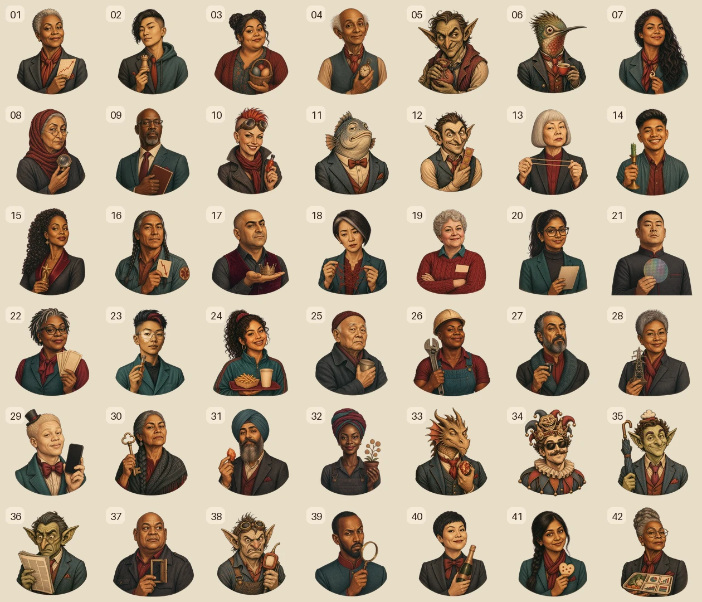

# Generated Brain Art

The Brain screen uses a hybrid art and interaction system:

- `apps/web/public/brain-art/v3/piece-01.webp` through `piece-42.webp` are the current transparent collectible portraits in canonical catalog order. The versioned directory prevents stale browser caches.
- `apps/web/lib/brain-presentation.ts` is the 42-entry visual manifest and anatomical source of truth. It contains one continuous traced lateral-brain silhouette plus semantic cerebrum, cerebellum, and brainstem placement metadata, curved path geometry, centers, directional keyboard neighbors, and portrait transforms separately from economic catalog data.
- `apps/web/components/brain-map.tsx` uses those 42 accessible SVG paths for hit testing, roving keyboard focus, ownership state, selection, data-mode fills, and clipping.
- The raster artwork is presentation only. It never replaces the accessible SVG interaction model or the on-chain piece identity.

## V3 generation direction

All artwork was generated with the built-in ImageGen workflow and then locally chroma-keyed to alpha. The shared prompt direction was:

> Engraved editorial screen-print illustration with warm parchment faces and clothing, dark charcoal crosshatching, restrained oxblood and muted teal accents, consistent head-and-shoulders framing, one character-defining prop, a uniform magenta key background, and no embedded text, numbers, frame, scenery, watermark, or brand logo.

The v3 collection keeps the locked editorial style while deliberately separating the cast by age, sex and gender presentation, race and ethnicity, face shape, body type, hair, silhouette, expression, and prop. Thirty-three human portraits were regenerated individually. Nine already-distinct beast and character portraits were retained: pieces 5, 6, 11, 12, 33, 34, 35, 36, and 38. Character identity follows `BRAIN_CHARACTERS.md`.

The magenta sources were keyed with the ImageGen chroma-key helper, downsampled as complete canvases to preserve apparent scale, and encoded as transparent 384 by 384 WebPs. `build-v3-assets.py` records the source-to-piece mapping and repeatable asset build. The retained project deliverables are the v3 WebPs and the contact sheet above.

## Runtime constraints

- Each piece asset is 384 by 384 with transparency.
- The 42 v3 portraits total less than 1.5 MB.
- Portraits are clipped to their own curved SVG segment.
- Theme-aware vector backplates remain visible below transparent portrait areas.
- The anatomical distribution is 34 cerebrum pieces, 6 cerebellum pieces, and 2 brainstem pieces. These labels guide placement only: every cell is tessellated inside the same continuous outer mask. This presentation grouping does not alter catalog IDs or economics.
- Characters mode uses 58% opacity and 35% saturation at rest, 85% on preview, and full color on selection.
- The Brain keeps one character-first portrait treatment. Ownership remains visible through the halo and `Yours` filter; influence and current mood remain explicit in accessible labels, tooltips, and the selected-piece inspector.
- Accessible names come from catalog data, not text embedded in the image.
