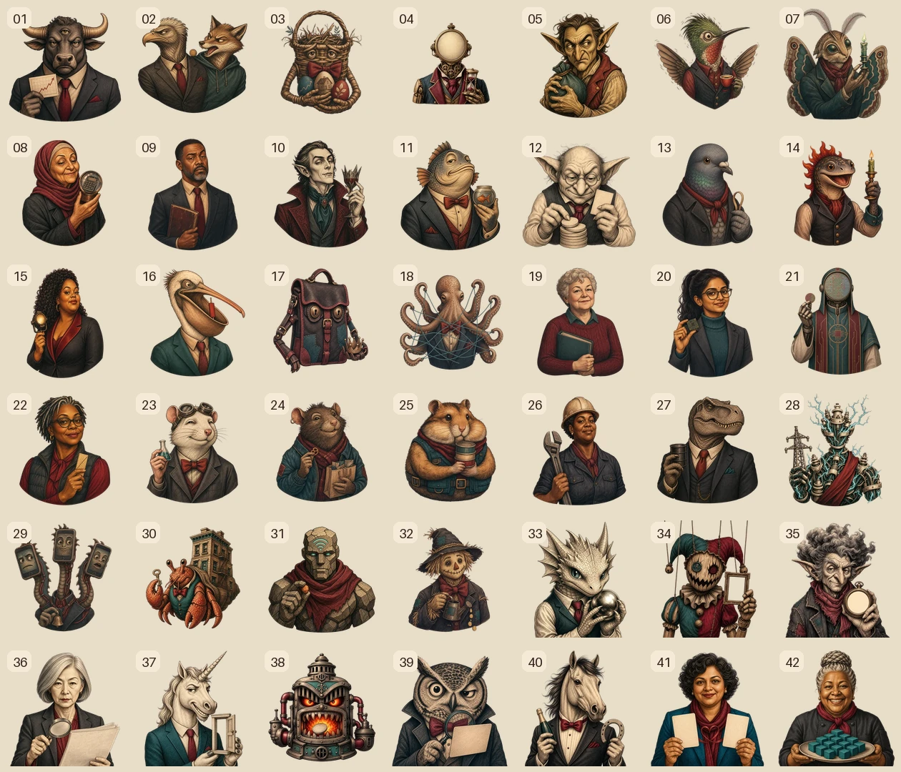

# Generated Brain Art

The Brain screen uses a hybrid art and interaction system:

- `apps/web/public/brain-art/v4/piece-01.webp` through `piece-42.webp` are the current transparent collectible portraits in canonical catalog order. The versioned directory prevents stale browser caches.
- `apps/web/lib/brain-presentation.ts` is the 42-entry visual manifest and anatomical source of truth. It contains one continuous traced lateral-brain silhouette plus semantic cerebrum, cerebellum, and brainstem placement metadata, curved path geometry, centers, directional keyboard neighbors, and portrait transforms separately from economic catalog data.
- `apps/web/components/brain-map.tsx` uses those 42 accessible SVG paths for hit testing, roving keyboard focus, ownership state, selection, data-mode fills, and clipping.
- The raster artwork is presentation only. It never replaces the accessible SVG interaction model or the on-chain piece identity.

## V4 generation direction

All artwork was generated with the built-in ImageGen workflow and then locally chroma-keyed to alpha. The shared prompt direction was:

> Engraved editorial screen-print illustration with warm parchment faces and clothing, dark charcoal crosshatching, restrained oxblood and muted teal accents, consistent head-and-shoulders framing, one character-defining prop, a uniform magenta key background, and no embedded text, numbers, frame, scenery, watermark, or brand logo.

The v4 collection is a coherent financial fever-dream bureaucracy: 10 humans and 32 creatures, machines, monsters, sentient objects, or supernatural characters. Every portrait was generated individually with the locked editorial style. The humans deliberately differ by age, race and ethnicity, gender presentation, face shape, build, hair, and styling. Every nonhuman differs by species and silhouette, rather than clothing alone. Character identity follows `BRAIN_CHARACTERS.md`; economic identity remains catalog v3.

The magenta sources were keyed with the ImageGen chroma-key helper, downsampled as complete canvases to preserve apparent scale, and encoded as transparent 384 by 384 WebPs. `build-v4-assets.py` records the source-to-piece mapping and repeatable asset build. The retained project deliverables are the v4 WebPs and the contact sheet above. V3 remains in the repository as the previous cache-safe roster and is not overwritten.

## Runtime constraints

- Each piece asset is 384 by 384 with transparency.
- The 42 v4 portraits total about 1.58 MB.
- Portraits are clipped to their own curved SVG segment.
- Theme-aware vector backplates remain visible below transparent portrait areas.
- The anatomical distribution is 34 cerebrum pieces, 6 cerebellum pieces, and 2 brainstem pieces. These labels guide placement only: every cell is tessellated inside the same continuous outer mask. This presentation grouping does not alter catalog IDs or economics.
- Characters mode uses 58% opacity and 35% saturation at rest, 85% on preview, and full color on selection.
- The Brain keeps one character-first portrait treatment. Ownership remains visible through the halo and `Yours` filter; influence and current mood remain explicit in accessible labels, tooltips, and the selected-piece inspector.
- Accessible names come from catalog data, not text embedded in the image.
- Owner profile media may be a normalized static WebP or a preserved animated
  GIF/WebP. Hash-keyed self-hosted media is clipped by the same SVG segments as
  the canonical art; animation never changes hit testing or economic identity.
- An owner may include one optional HTTPS profile link in the same one-time
  name-and-media transaction. It is presentation-only and never enters the AI
  context. Admins can independently reset custom media or clear the link
  without restoring the owner's consumed customization.
