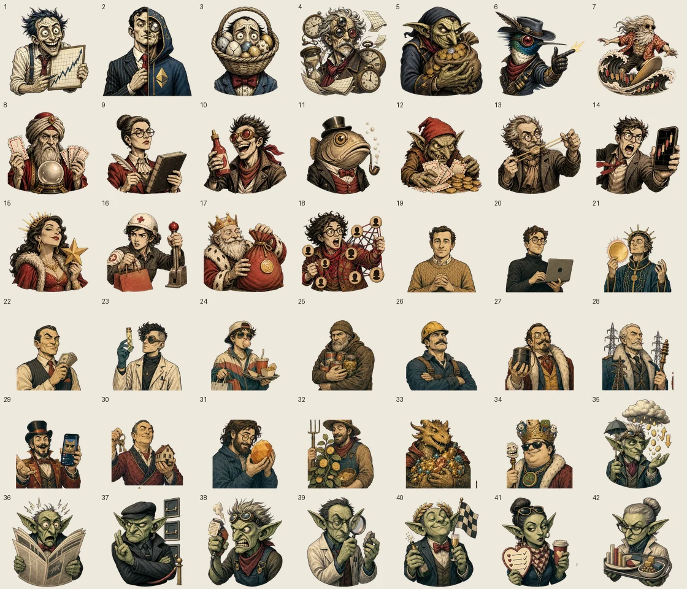

# Generated Brain Art

The Brain screen uses a hybrid art and interaction system:

- `apps/web/public/brain-art/brain-base.webp` is the transparent editorial brain illustration.
- `apps/web/public/brain-art/piece-01.webp` through `piece-42.webp` are transparent collectible portraits in canonical catalog order.
- `apps/web/components/brain-map.tsx` retains 42 accessible SVG paths for hit testing, keyboard focus, ownership state, selection, and clipping.
- The raster artwork is presentation only. It never replaces the accessible SVG interaction model or the on-chain piece identity.

## Final generation direction

All artwork was generated with the built-in ImageGen workflow and then locally chroma-keyed to alpha. The shared prompt direction was:

> Sophisticated editorial screen-print illustration with engraved charcoal linework, paper-cut shapes, mature financial-magazine art direction, warm parchment, oxblood, muted terracotta, slate blue, aged gold, bold small-scale silhouettes, no text, no watermark, no glossy 3D, no photorealism, and no neon cyberpunk styling.

The brain prompt required a recognizable side-view human brain with a small brainstem, articulated lobes, sulci, and gyri on a flat green key background. Character production used four ordered crew atlases on flat magenta key backgrounds:

1. Executive Dysfunction: pieces 1 through 6 in a 3 by 2 atlas.
2. Market Mystics: pieces 7 through 18 in a 4 by 3 atlas.
3. Sector Weirdos: pieces 19 through 34 in a 4 by 4 atlas.
4. Decision Goblins: pieces 35 through 42 in a 4 by 2 atlas.

Every character prompt followed the names and metaphors in `BRAIN_CHARACTERS.md`. Production sources were removed after alpha extraction; the checked-in WebP assets are the optimized project deliverables.

## Runtime constraints

- Each piece asset is 384 by 384 with transparency.
- The complete served art set is approximately 2 MB.
- Portraits are clipped to their own irregular SVG segment.
- The generated brain remains visible below transparent portrait areas.
- Light and dark themes may adjust opacity, saturation, and outline contrast, but must not recolor the character identity.
- Accessible names come from catalog data, not text embedded in the image.
