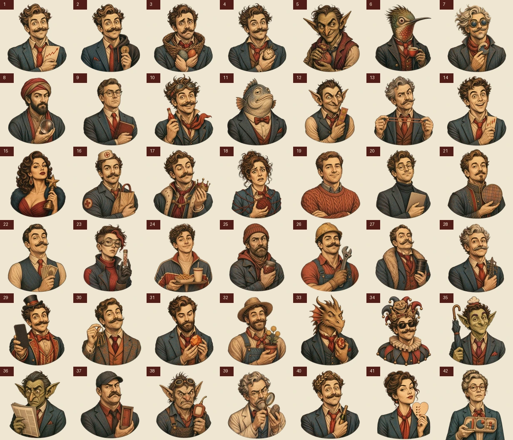

# Generated Brain Art

The Brain screen uses a hybrid art and interaction system:

- `apps/web/public/brain-art/brain-base.webp` is the transparent editorial brain illustration.
- `apps/web/public/brain-art/v2/piece-01.webp` through `piece-42.webp` are the current transparent collectible portraits in canonical catalog order. The versioned directory prevents stale browser caches.
- `apps/web/lib/brain-presentation.ts` is the 42-entry visual manifest. It keeps curved path geometry, centers, directional keyboard neighbors, and portrait transforms separate from economic catalog data.
- `apps/web/components/brain-map.tsx` uses those 42 accessible SVG paths for hit testing, roving keyboard focus, ownership state, selection, data-mode fills, and clipping.
- The raster artwork is presentation only. It never replaces the accessible SVG interaction model or the on-chain piece identity.

## V2 generation direction

All artwork was generated with the built-in ImageGen workflow and then locally chroma-keyed to alpha. The shared prompt direction was:

> Engraved editorial screen-print illustration with warm parchment faces and clothing, dark charcoal crosshatching, restrained oxblood and muted teal accents, consistent head-and-shoulders framing, one character-defining prop, a uniform magenta key background, and no embedded text, numbers, frame, scenery, watermark, or brand logo.

The v2 collection was generated one character at a time. Piece 1 established the locked style reference; pieces 2 through 42 used piece 1 and the brain illustration as visual references. Character identity follows `BRAIN_CHARACTERS.md`.

The magenta sources were keyed with the ImageGen chroma-key helper, downsampled as complete canvases to preserve apparent scale, and encoded as transparent 384 by 384 WebPs. The retained project deliverables are the v2 WebPs and the contact sheet above.

## Runtime constraints

- Each piece asset is 384 by 384 with transparency.
- The 42 v2 portraits total approximately 1.8 MB.
- Portraits are clipped to their own curved SVG segment.
- The generated brain remains visible below transparent portrait areas.
- Characters mode uses 58% opacity and 35% saturation at rest, 85% on preview, and full color on selection.
- Ownership, Influence, and Mood may neutralize portraits while accessible legends and the selected-piece inspector communicate the underlying value.
- Accessible names come from catalog data, not text embedded in the image.
